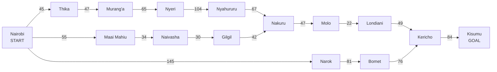
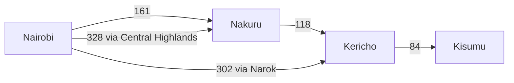
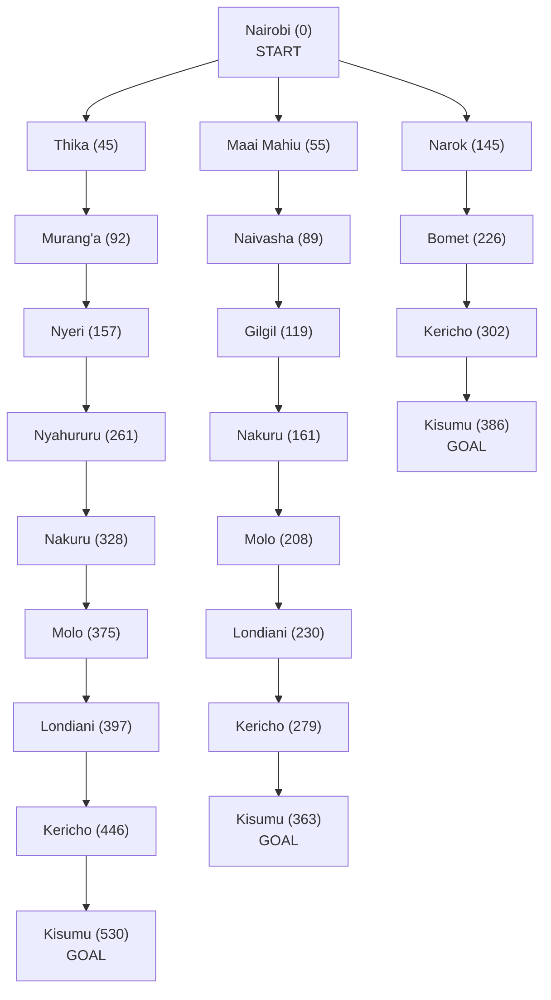

## Practical Exercise 3: Designing a Searching Agent

---

## 1. Designing the Self-Driving Trailer Agent

### 1.1 PEAS framework

| PEAS element | Description for the self-driving trailer |
|---|---|
| **Performance measure** | Reach Kisumu safely and on time; keep the distance travelled as short as possible; obey traffic laws; avoid collisions; protect the cargo and other road users; use fuel efficiently. |
| **Environment** | Kenya's highway network linking Nairobi, the Central Highlands, the Rift Valley and the Lake Victoria Basin: towns, junctions, road signs, other vehicles, pedestrians, animals, weather and roadworks. |
| **Actuators** | Steering, accelerator, brakes, gear control, indicators, headlights, horn and the navigation display. |
| **Sensors** | GPS, cameras, radar/lidar, speedometer, wheel sensors, digital maps, live traffic feed and sensors monitoring the trailer and cargo. |

### 1.2 The five properties of the environment

| Property | Classification | Why |
|---|---|---|
| Fully vs. partially observable | **Partially observable** | Sensors have limited range and blind spots; hidden hazards and other drivers' intentions cannot be known. |
| Deterministic vs. stochastic | **Stochastic** | The same action can have different outcomes because of other drivers, weather and unexpected hazards. |
| Episodic vs. sequential | **Sequential** | Each decision (route, speed) affects later ones such as fuel use, safety and arrival time. |
| Static vs. dynamic | **Dynamic** | Vehicles move and traffic and weather change while the agent is deciding. |
| Discrete vs. continuous | **Continuous** | Position, speed, steering and time vary continuously. (The route planner treats towns as discrete states.) |

The trailer is a **goal-based agent**: it chooses actions to reach a destination. When it compares routes by distance, it also acts as a **utility-based agent**.

---

## 2. Directed Graph and Search Tree

### 2.1 Problem formulation

We formulate the route-finding task as a search problem:

- **State:** the town the trailer is currently in.
- **Start:** Nairobi.
- **Goal test:** the trailer is in Kisumu.
- **Actions:** take the highway from the current town to a connected neighbouring town.
- **Result of an action:** after driving the road from A to B, the trailer's state is B.
- **Cost:** the length of each road in km, added up along the route.

### 2.2 Directed graph

The graph uses the towns shown on the Google Maps view of the Nairobi, Central Highlands, Rift Valley and Lake Victoria Basin regions. Each arrow is a road, and the number is its driving distance in km from Google Maps.

There are three ways out of Nairobi: through the Central Highlands (Thika), along the main highway to Nakuru (Maai Mahiu), and through Narok.

### 2.3 Abstraction

Real driving has too much detail to plan with: bends, lanes, junctions, gradients and traffic. Abstraction removes the detail the search does not need. This is done at two levels.

**Regional level.** Before looking at roads, the agent only decides which regions to cross: from Nairobi into the Rift Valley and on to the Lake Victoria Basin, where Kisumu lies. The Central Highlands is an optional detour on the way.

**Corridor level.** Inside a region, a whole stretch of highway is folded into a single move, and only broken into individual towns when the trailer actually drives it:

- Nairobi to Nakuru via Maai Mahiu, Naivasha and Gilgil: one action, 161 km
- Nairobi to Nakuru via Thika, Murang'a, Nyeri and Nyahururu: one action, 328 km
- Nakuru to Kericho via Molo and Londiani: one action, 118 km
- Nairobi to Kericho via Narok and Bomet: one action, 302 km
- Kericho to Kisumu: one action, 84 km

### 2.4 Search tree

The number beside each town is the total distance from Nairobi to reach it along that branch. Nakuru, Kericho and Kisumu are repeated because more than one road leads to them.

---

## 3. Optimal Path from Nairobi to Kisumu

### 3.1 Distances between towns

Driving distances from Google Maps, in km.

| Segment | Distance (km) |
|---|---:|
| Nairobi → Thika | 45 |
| Thika → Murang'a | 47 |
| Murang'a → Nyeri | 65 |
| Nyeri → Nyahururu | 104 |
| Nyahururu → Nakuru | 67 |
| Nairobi → Maai Mahiu | 55 |
| Maai Mahiu → Naivasha | 34 |
| Naivasha → Gilgil | 30 |
| Gilgil → Nakuru | 42 |
| Nakuru → Molo | 47 |
| Molo → Londiani | 22 |
| Londiani → Kericho | 49 |
| Nairobi → Narok | 145 |
| Narok → Bomet | 81 |
| Bomet → Kericho | 76 |
| Kericho → Kisumu | 84 |

### 3.2 Routes and their total distances

| No. | Route | Calculation | Distance (km) |
|---|---|---|---:|
| 1 | Nairobi → Maai Mahiu → Naivasha → Gilgil → Nakuru → Molo → Londiani → Kericho → Kisumu | 55 + 34 + 30 + 42 + 47 + 22 + 49 + 84 | **363** |
| 2 | Nairobi → Narok → Bomet → Kericho → Kisumu | 145 + 81 + 76 + 84 | 386 |
| 3 | Nairobi → Thika → Murang'a → Nyeri → Nyahururu → Nakuru → Molo → Londiani → Kericho → Kisumu | 45 + 47 + 65 + 104 + 67 + 47 + 22 + 49 + 84 | 530 |

### 3.3 Uniform-cost search

With distance as the cost, uniform-cost search always picks the town on the frontier that is cheapest to reach so far.

| Step | Town selected | Cost so far (km) | Towns added or improved |
|---:|---|---:|---|
| 1 | Nairobi | 0 | Thika 45, Maai Mahiu 55, Narok 145 |
| 2 | Thika | 45 | Murang'a 92 |
| 3 | Maai Mahiu | 55 | Naivasha 89 |
| 4 | Naivasha | 89 | Gilgil 119 |
| 5 | Murang'a | 92 | Nyeri 157 |
| 6 | Gilgil | 119 | Nakuru 161 |
| 7 | Narok | 145 | Bomet 226 |
| 8 | Nyeri | 157 | Nyahururu 261 |
| 9 | Nakuru | 161 | Molo 208 |
| 10 | Molo | 208 | Londiani 230 |
| 11 | Bomet | 226 | Kericho 302 |
| 12 | Londiani | 230 | Kericho 279 (better than 302, replaces it) |
| 13 | Nyahururu | 261 | Nakuru 328 (worse than 161, ignored) |
| 14 | Kericho | 279 | Kisumu 363 |
| 15 | Kisumu | 363 | **Goal reached** |

Since every road has a positive length, no cheaper path to Kisumu can appear once it has been selected at 363 km. This is why the search can stop there.

### 3.4 Answer

**Optimal path:** Nairobi → Maai Mahiu → Naivasha → Gilgil → Nakuru → Molo → Londiani → Kericho → Kisumu

**Total distance:** 55 + 34 + 30 + 42 + 47 + 22 + 49 + 84 = **363 km**

This is 23 km shorter than the route through Narok and Bomet (386 km) and 167 km shorter than the route through the Central Highlands (530 km).

---

